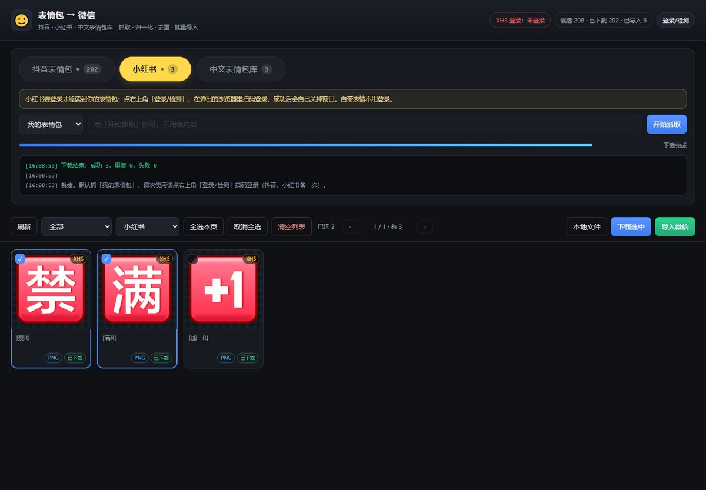
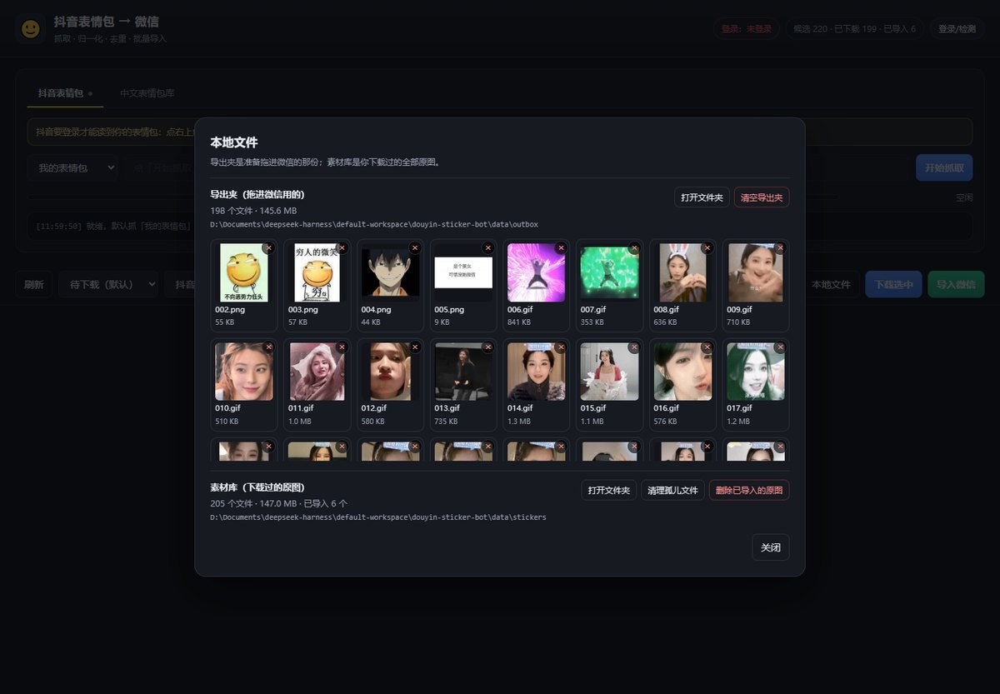
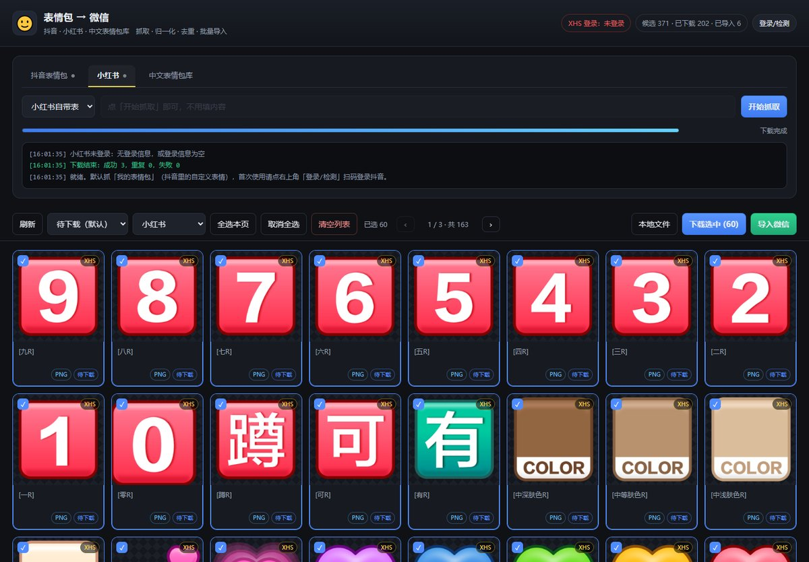
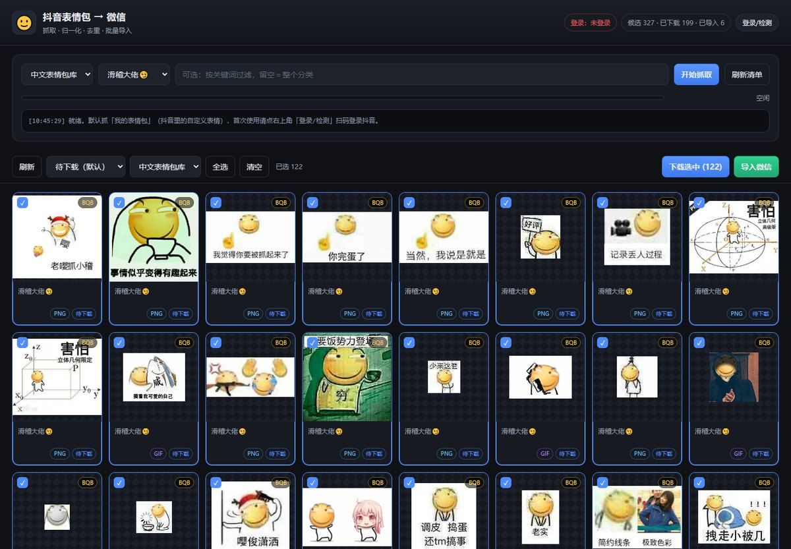

# 表情包 → 微信（DSH 插件 / 独立控制台）

把**你自己账号里的表情包**一次拉全，统一成微信表情规格（240×240 PNG/GIF），批量导出后拖进微信表情面板。

支持三个来源，页签切换、各管各的：

| 来源 | 抓什么 | 要登录 |
| --- | --- | --- |
| 抖音 | 「我的表情包」= 评论表情面板里 ❤ 那一栏（自定义表情） | 扫一次码 |
| 小红书 | 「我的表情包」/「小红书自带表情」（166 个，免登录） | 前者扫一次码 |
| 中文表情包库 | [ChineseBQB](https://github.com/zhaoolee/ChineseBQB) 的 115 个分类、5886 张图 | 不需要 |



| 本地文件管理 | 小红书自带表情 |
| --- | --- |
|  |  |



## 安装

### 方式一：一条命令（推荐，给别人用）

```bat
dsh plugin --profile desktop add github:XuConan/dsh-stickers
```

装完重启 Harness 桌面应用。插件会自己找包里的 `douyin-sticker-bot`，**第一次启动时自动建 venv 装依赖**（约 1–2 分钟，面板会显示「第一次启动要先装 Python 依赖…」），装完自动加载。

前提：本机有 Python 3.9+ 在 PATH 里；`dsh` 命令可用（DSH 装好后在 `resources\runtime\cli\bin\dsh.cmd`，没进 PATH 就用全路径）。

### 方式二：一键包（离线/不想连 GitHub）

从 [Releases](../../releases) 下载 `dsh-stickers-portable.zip` → 解压到固定目录（比如 `D:\sticker-kit`，**之后别挪、别删**）→ 双击 `install.bat` → 重启 Harness 桌面应用。

`install.bat` 依次做三件事：找 `dsh` 命令 → 建好 Python 环境（首次 1–2 分钟）→ 把插件装进 `desktop` profile。装到别的 profile：`install.bat <profile名>`。Python 环境没装成也不影响使用，插件首次启动会自己补。

### 方式三：从源码改代码

```bat
git clone <this-repo> dsh-stickers-repo
cd dsh-stickers-repo
douyin-sticker-bot\run.bat --help          :: 建 venv + 装依赖
dsh plugin --profile desktop add .
```

以后改完代码，重启 Harness 即可（`link:`/目录安装，不用重装）。

### 方式四：只要独立控制台（不装 DSH 插件）

```bat
cd douyin-sticker-bot
run.bat
```

跑完自动开浏览器到 `http://127.0.0.1:8799`。功能与插件面板一致。

## 用法

1. 顶部页签选来源；首次用抖音/小红书点右上角 **登录/检测**，在弹出的浏览器里扫码（顺带过一下滑块）。
2. 点 **开始抓取**，候选进列表。列表默认只显示**待下载**，已下载的自动消失——切筛选能看全。
3. 勾选（或「全选本页」）→ **下载选中**。动图 webp 自动转 GIF，静态图转 PNG，全部 240×240。
4. **导入微信** → 素材平铺到 `data/outbox` 并打开文件夹、唤起微信 → 全选拖进微信表情面板 → 回来点 **我已导入**。
5. 右上角 **本地文件** 可以单删/清空导出夹、清理孤儿文件、删除已导入原图。

> 微信那一步是**半自动**：微信的表情数据库是加密的（SQLCipher），我们不碰它，靠拖拽导入最稳。

## 它怎么工作

不是爬网页，是直接读这三个来源自己的接口：

| 来源 | 接口 |
| --- | --- |
| 抖音 | 浏览器（Playwright + 本机 Chrome）打开个人主页，拦截页面自己发出的已签名请求：`aweme/v1/web/im/resource/list/aggregation/?scenes=CUSTOM_STICKER_PAGE`（表情包本身） |
| 小红书 | `edith.xiaohongshu.com/api/im/web/smiles`（我的表情包）、`/api/im/redmoji/detail`（自带表情）；这两个**不需要 x-s 签名，只要 cookie**，所以直接 requests 抓，不开浏览器 |
| ChineseBQB | `api.github.com/repos/zhaoolee/ChineseBQB/git/trees/master?recursive=1` 取清单（缓存 24h），图片走 `raw.githubusercontent.com` |

**不自己拼签名、不破解、不写微信数据库。** 抖音那边用真浏览器让页面自己发请求，我们只读响应。

工程细节：

- 归一化：240×240（微信显示约 120px，2x 更清晰），GIF 保留透明、≤1.5 MB、≤200 帧、`loop=0`；超限自动降规格并抽帧，兜底首帧 PNG。
- 去重：sha256 精确 + dHash 感知（汉明距离 ≤6）。贴纸 URL 带签名参数每次都变，所以按 `aweme_id`/`external_id` 查重。
- 列表每页 60，缩略图压缩到 360px（单图约 26 KB）、`loading="lazy"`，翻页 60–100 ms。
- 数据全在本地：`douyin-sticker-bot/data/`（sqlite + 素材库 + 导出夹 + 登录态）。

## 隐私

- cookie 只落在本机 `douyin-sticker-bot/data/`（`xhs-cookies.json`、`browser-profile*/`），**没有任何上报**。
- 抓到的都是你自己账号里已有的表情，工具只是把它们取到本地。
- 面板监听 `127.0.0.1`，不对外。

## 常见问题

| 现象 | 处理 |
| --- | --- |
| 抖音提示要过滑块 | 在弹出的浏览器里手动拖一下，程序会等你（默认 300 秒） |
| 抓不到/一条都没有 | 先点右上角「登录/检测」确认登录态；抖音主页的「收藏/喜欢」要真正登录后才可见 |
| 中文表情包库报限流 | GitHub 未鉴权 60 次/小时；清单有 24h 缓存，过会儿再点「刷新清单」 |
| 有的格子显示「原图太大，下载后可看」 | 缩略图有 12 秒/12 MB 上限，避免一张图卡死整页；下载不受影响 |
| 抓了一大堆竖图/视频 | 抖音那栏抓的是「表情包」，图文混排的作品会被尺寸/视频规则过滤掉 |
| 微信里显示不清晰 | 微信表情显示约 120px，240×240 是 2x 输出，属正常上限 |

## 开发

```bat
:: 测试（无需 pytest）
douyin-sticker-bot\.venv\Scripts\python.exe -m unittest discover -s tests -t .\douyin-sticker-bot
:: 打安装包
python scripts\make_install_bat.py   :: 生成 install.bat（GBK + CRLF）
python scripts\build-dist.py         :: dist\*.tgz + dsh-stickers-portable.zip
```

目录（插件本体就在仓库根目录，这样 `dsh plugin add github:...` 能直接装）：

```
package.json / index.js / client.js    DSH 插件（Host: index.js / Client: client.js）
cordis.patch.yml / locale / icon.svg   插件清单与文案
install.bat                            一键安装（便携包用）
scripts/                               打包、校验、面板离线渲染
douyin-sticker-bot/                    Python 后端 + 独立控制台（app/、tests/）
docs/screenshots/                      README 用的截图
```

要求：Windows 10/11、Python 3.10+；装 Chrome 或 Edge（Playwright 用本机浏览器，不下载 Chromium）。

## 免责

仅供个人备份自己账号里的表情使用。请遵守各平台用户协议，不要公开传播抓取到的他人作品，也不要高频请求。接口随时可能变，坏了请提 issue。

MIT License
